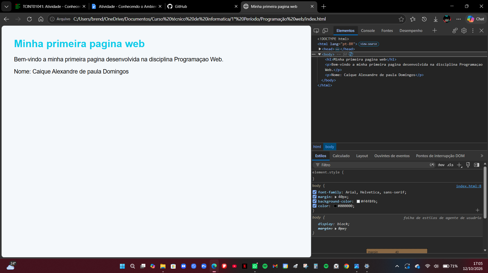

##Minha primeira pagina web

Nome: Caique Alexandre de Paula Domingos

##Sobre a atividade

Esta e minha primeira página desenvolvida na disciplina Programação Web.

Tecnologias utilizadas

-HTML
-Git
-GitHub

##Captura de tela

Adicione aqui uma captura de tela mostrando a página aberta no navegador e uma propriedade visual alterada no DevTools

Exemplo:

